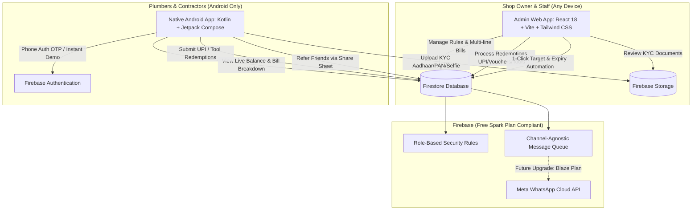

# Shiv Agency — Loyalty Rewards System
### Complete Plumber & Contractor Rewards Platform (Admin Web + Native Android)

A complete, production-ready loyalty rewards platform built for **Shiv Agency** (plumbing, sanitary, and building materials dealer in Karauli, Rajasthan). 

Plumbers and contractors who buy materials from Shiv Agency earn reward points based on flexible category and brand rules. Shop staff credit points from the responsive Admin Web App, and contractors track balances, view itemized bill arithmetic, and redeem rewards (UPI cash, shopping vouchers, and physical plumbing tools) exclusively through the native Android app.

---

## 🏛️ System Architecture



---

## 🚀 Key Highlights & Spark Plan Compliance

1. **100% Free Tier (Spark Plan) Compliant**:
   - Cloud Functions and scheduled cron jobs require the paid Blaze plan. All v1 balance calculations, redemptions, and point additions execute through client-side **atomic Firestore transactions**.
   - Monthly milestone bonuses and points expiry checks are executed with **1-click manual admin triggers** directly from the Admin Dashboard.
2. **Dynamic Business Values (Zero Hardcoding)**:
   - Fallback earn rate (%), rupee value per point (₹1 = 1 pt default), minimum redeem points (3,000 pts default), welcome bonus (500 pts), referral bonus (50 pts), points expiry months (6 months), and festival multipliers are all live-managed in `appSettings/general`.
3. **Plumbers are strictly Android-only**:
   - Clean, modern Material 3 Jetpack Compose UI with 3 persistent color themes (Royal Blue, Ruby Red, Charcoal & Orange) and bilingual support (Hindi & English).

---

## 📋 Beginner-Friendly Setup Instructions

### Part 1: Firebase Project Setup

1. Go to the [Firebase Console](https://console.firebase.google.com/) and create a new project named `shiv-agency-rewards`.
2. Enable **Authentication**:
   - Click **Build** > **Authentication** > **Sign-in method**.
   - Enable **Email/Password** (used by Admin staff).
   - Enable **Phone** (used by Plumbers).
   - *(Optional for testing without SMS)*: Expand **Phone numbers for testing** and add `+91 9999999999` with test code `123456`.
3. Enable **Cloud Firestore**:
   - Click **Build** > **Firestore Database** > **Create database**.
   - Start in **Test mode** (or deploy our pre-configured `firestore.rules`).
4. Enable **Firebase Storage**:
   - Click **Build** > **Storage** > **Get started**.
5. Deploy Security Rules:
   - Copy the contents of [`firestore.rules`](file:///c:/Users/DELL/Documents/antigravity/modest-franklin/firestore.rules) into the Firestore **Rules** tab and click **Publish**.
   - Copy the contents of [`storage.rules`](file:///c:/Users/DELL/Documents/antigravity/modest-franklin/storage.rules) into the Storage **Rules** tab and click **Publish**.

---

### Part 2: Running the Admin Web App

The Admin Web App is built with React, Vite, and Tailwind CSS. It is responsive for both desktop laptops and mobile phone browsers.

1. Open your terminal in the `admin/` directory:
   ```bash
   cd admin
   npm install
   ```
2. Configure Firebase credentials:
   - Copy `.env.sample` to `.env` in the `admin/` folder:
     ```bash
     cp .env.sample .env
     ```
   - Paste your Firebase Web App configuration keys from the Firebase Console (Project Settings > General > Your Apps > Web App).
3. Start the local development server:
   ```bash
   npm run dev
   ```
4. Open `http://localhost:3000` in your browser.
5. **First Admin Registration**:
   - On the login screen, click **"Create First Owner Account"**.
   - Register with your email (e.g. `owner@shivagency.com`) and password.
   - The system automatically creates your owner profile and seeds default categories, brands, points rules, and business settings!

---

### Part 3: Running the Plumber Android App

The Android app is located in `android/` and built with native **Kotlin** and **Jetpack Compose**.

1. Download `google-services.json`:
   - In [Firebase Console](https://console.firebase.google.com/), go to **Project settings** > **Your apps** > **Add app** > **Android**.
   - Package name: `com.shivagency.rewards`.
   - Download `google-services.json` and place it in `android/app/google-services.json`.
2. Open Android Studio:
   - Click **Open** and select the `android/` folder.
   - Allow Gradle to sync.
3. Run the App:
   - Select an Android Virtual Device (Emulator) running API 26+ (Android 8.0+) or connect a physical Android phone via USB with USB Debugging enabled.
   - Click the green **Play (Run)** button.
4. **Effortless 1-Tap Demo Testing**:
   - On the login screen, tap the amber **"Instant Demo Login (Bypass SMS)"** button.
   - This immediately signs you in as demo plumber **Ramesh Kumar** (`SA-4821`), with pre-configured balance, KYC details, and active schemes!

---

## 🧪 Comprehensive Testing Checklist by Phase

| Phase | Feature Tested | How to Verify |
| :---: | :--- | :--- |
| **Phase 1** | Scaffolding & Theme Engine | Open Admin (`localhost:3000`) and Android app. Verify responsive design and color palettes. |
| **Phase 2** | Auth, KYC & Document Review | Register a plumber in Android (PAN, Aadhaar last-4, live selfie). Inspect documents in Admin (`/plumbers`) and click **"Approve KYC"**. |
| **Phase 3** | Multi-Line Rules & Add Points | Go to `/add-points` in Admin. Add a bill with CPVC and Water Tanks. Observe automatic rule matching, arithmetic calculation, and tap to view the plain calculation breakdown in Android Statement. |
| **Phase 4** | Live Business Settings & Schemes | Edit minimum redeem points in Admin (`/settings`). Observe the progress bar and requirements on Android Home update instantly. Add a scheme in `/schemes` and observe the auto-scrolling photo slider. |
| **Phase 5** | Redemption & Catalogue | Seed default tools and vouchers in Admin (`/redemptions`). In Android, submit a UPI cash request or claim a 14" Pipe Wrench. In Admin, enter bank UTR and click **"Approve & Pay"**; verify atomic point deduction. |
| **Phase 6** | Referrals, Bonuses & Leaderboard | Copy plumber referral code in Android (`/refer`), share via Android share sheet. Award points to a referred plumber to trigger the first-bill referral bonus. Check the **Monthly Champions** podium on both Admin and Android. Click **"Run Monthly Target Bonus"** in Dashboard. |
| **Phase 7** | WhatsApp Separation | Test 1-click free WhatsApp chat (`wa.me`) from Admin plumber rows. Inspect the prepared bilingual templates in `/messages`. Review [`WHATSAPP_SETUP_GUIDE.md`](file:///c:/Users/DELL/Documents/antigravity/modest-franklin/WHATSAPP_SETUP_GUIDE.md). |
| **Phase 8** | Theme Persistence & Production Build | Change theme in Android Settings to Ruby Red or Orange; restart app to verify persistence. Generate production bundle. |

---

## 📦 Production Deployment Guide

### Deploying the Admin Web App to Firebase Hosting

1. In the root directory, ensure you are logged into Firebase CLI:
   ```bash
   npm install -g firebase-tools
   firebase login
   firebase init hosting
   ```
   - When asked for the public directory, specify: `admin/dist`
   - Configure as a single-page app: `Yes`
2. Build the optimized production bundle:
   ```bash
   cd admin
   npm run build
   ```
3. Deploy to Firebase Hosting:
   ```bash
   firebase deploy --only hosting
   ```
4. Your Admin Web App will be live at `https://shiv-agency-rewards.web.app`!

---

### Generating a Signed Android App Bundle (AAB) for Google Play Store

1. In Android Studio, open the `android/` project.
2. In the top menu, go to **Build** > **Generate Signed Bundle / APK...**
3. Select **Android App Bundle** > Click **Next**.
4. Create or choose your keystore:
   - **Key store path**: Click *Create new...* (e.g. `shiv-agency-release.jks`).
   - Enter keystore password, key alias, and key password.
   - Enter Certificate details: First and Last Name (`Shiv Agency`), Organization (`Shiv Agency, Karauli`).
5. Select **release** as the build variant.
6. Check **V1 and V2 (Full APK Signature)** and click **Finish**.
7. The production `.aab` file will be generated in `android/app/release/app-release.aab`.
8. Upload this `.aab` to the [Google Play Console](https://play.google.com/console) under **Production** or **Internal Testing**.

---

## 🔒 Security & Data Privacy Measures

- **No Plaintext Aadhaar Storage**: In compliance with UIDAI guidelines, only the last 4 digits of Aadhaar numbers are stored in Firestore.
- **Isolated Storage Rules**: Plumbers can only upload KYC files during registration. KYC document photos can only be read and downloaded by verified Admin staff.
- **Ledger Immutability**: Historical purchase calculations store a permanent snapshot of rates, categories, and brands at that specific moment; later edits to point rules never retroactively alter past statements.
- **Tamper-Proof Transactions**: Point balances can only be modified via authenticated admin transactions; rogue client modifications cannot forge points or balances.
